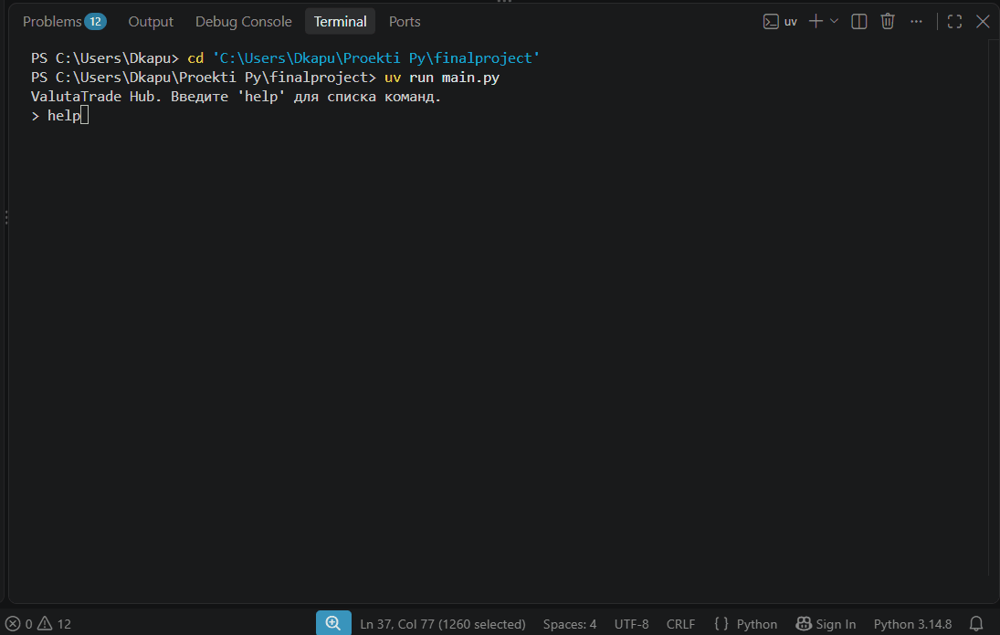

# ValutaTrade Hub

ValutaTrade Hub - консольное приложение для ведения личного портфеля валют
и криптовалют. Пользователь регистрируется, покупает и продаёт активы по курсу USD,
смотрит оценку портфеля в любой базовой валюте и работает с курсами,
которые Parser Service забирает из внешних API и хранит в локальном кеше.

## Возможности

- регистрация и вход пользователя (данные в `data/users.json`, портфель - в `data/portfolios.json`);
- покупка и продажа валют (`buy` / `sell`) с проверкой достаточности средств;
- оценка портфеля в произвольной базовой валюте (`show-portfolio --base EUR`) - кросс-курсы считаются через USD;
- запрос курса произвольной пары, включая обратные и кросс-курсы (`get-rate`);
- обновление курсов из внешних источников (`update-rates`, источники: `coingecko`, `exchangerate`);
- просмотр кешированных курсов в таблице с фильтрацией и пересчётом в другую базу (`show-rates`);
- обработка ошибок: недостаточно средств, неизвестная валюта, недоступный курс.

## Структура проекта

```
finalproject/
├── main.py                      # точка входа: запускает CLI
├── pyproject.toml               # зависимости, настройки ruff
├── valutatrade_hub/
│   ├── cli/                     # командный интерфейс: разбор команд, вывод
│   │   └── interface.py
│   ├── core/                    # бизнес-логика: usecases (register, buy, sell, get_rate...), исключения
│   ├── infra/                   # настройки приложения (settings.py)
│   └── parser_service/          # обновление курсов: api_clients, updater, storage, config
├── data/                        # данные во время работы (создаётся автоматически)
│   ├── users.json               # пользователи
│   ├── portfolios.json          # портфели
│   ├── rates.json               # кеш курсов
│   └── exchange_rates.json      # расширенные данные источников
├── logs/
│   └── parser.log               # журнал Parser Service
└── docs/
    └── demo.gif                 # демо-сессия CLI
```

## Установка

Проект использует [uv](https://docs.astral.sh/uv/) для управления зависимостями.

```bash
git clone https://github.com/kapustindv1984-beep/finalproject_Kapustin_-26-555.git
cd finalproject_Kapustin_-26-555
uv sync
```

Python 3.14+ (используется синтаксис PEP 758 в `except`).

## Запуск

```bash
uv run main.py
```

После старта введите `help`, чтобы увидеть список команд.

## Примеры команд CLI

```
> register --username demo --password qwerty123
Пользователь 'demo' зарегистрирован (id=1).
Стартовый капитал: 1,000.00 USD

> login --username demo --password qwerty123
Вы вошли как 'demo'

> buy --currency BTC --amount 0.01
Покупка выполнена: 0.0100 BTC по курсу 59,337.21 USD/BTC

> sell --currency BTC --amount 0.005
Продажа выполнена: 0.0050 BTC

> sell --currency EUR --amount 500
Ошибка: Недостаточно средств: доступно 100.0000 EUR, требуется 500.0000 EUR

> show-portfolio --base EUR
Портфель пользователя 'demo' (база: EUR): ... ИТОГО: 927.13 EUR

> get-rate --from RUB --to USD
Курс RUB→USD: 0.01016000 (обновлено: 2026-11-07 21:09:46+00:00)
Обратный курс USD→RUB: 98.4252

> update-rates
Update successful. Total rates updated: 7. Last refresh: 2026-11-07T21:10:28Z

> show-rates --currency BTC --top 2 --base EUR
+---------+--------------+
|   Pair  |     Rate     |
+---------+--------------+
| BTC_EUR | 67732.607373 |
+---------+--------------+

> exit
Bye!
```

Поддерживаемые коды валют: `USD`, `EUR`, `GBP`, `RUB`, `BTC`, `ETH`, `SOL`.

## Кеш курсов и TTL

Курсы хранятся в `data/rates.json` в виде пар `CODE_CODE` с меткой обновления
(`last_refresh`). Логика работы с кешем:

- `show-rates` читает только локальный кеш — сетевых запросов не делает;
- `get-rate` сначала проверяет кеш: если запись свежее TTL (по умолчанию
  **300 секунд**, задаётся в настройках приложения), курс берётся из кеша,
  иначе — запрашивается из API и записывается в кеш;
- TTL и пути к файлам задаются в настройках через `SettingsLoader`
  (`valutatrade_hub/infra/settings.py`).

## Parser Service и API-ключи

Parser Service включается прямо из CLI командой `update-rates` (отдельный
запуск не требуется):

```
> update-rates [--source coingecko|exchangerate]
```

Без флага `--source` обновляются все доступные источники; результат каждого
источника фиксируется в `logs/parser.log`.

### Ключи API

Для `update-rates` нужен API-ключ [Exchangerate-API](https://www.exchangerate-api.com) -
он берётся из переменной окружения `EXCHANGERATE_API_KEY`. Укажите его в файле
`.env` в корне проекта (в git не попадает, подхватывается автоматически):

```
EXCHANGERATE_API_KEY=<ваш ключ>
```

CoinGecko (криптовалюты) работает без ключа.


## Демо

Демонстрация полного цикла работы CLI (регистрация, торговля, портфель,
ошибки, обновление и просмотр курсов):



## Проверка качества

```bash
uv run ruff check .
uv run ruff format --check .
```
